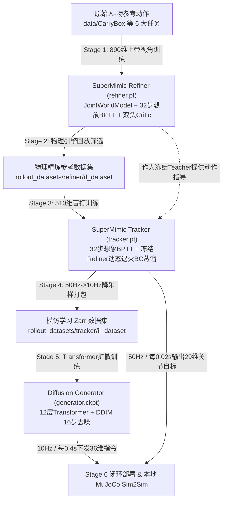
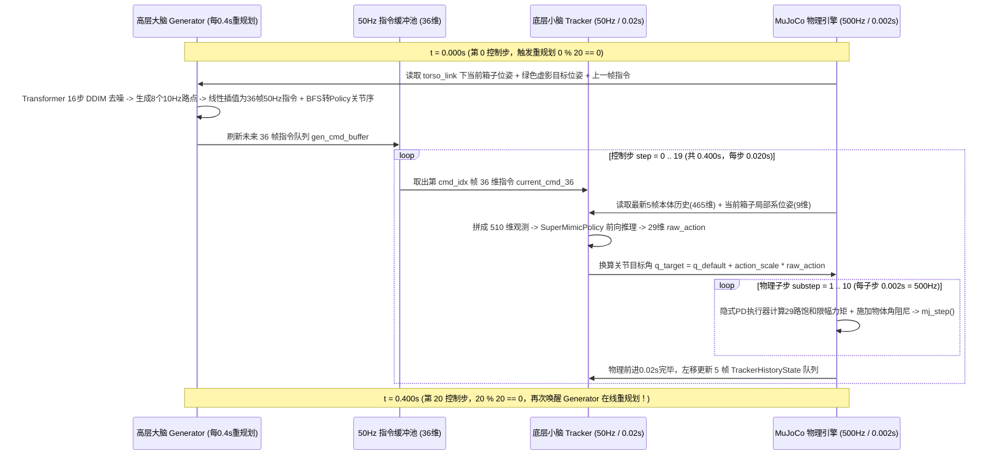

# SuperMimic × SUGAR 全身人-物交互融合项目：从零基础入门到抗住面试深挖的逐帧学习手册

> **阅读指南**：这是一份专为**零基础小白**量身定制、同时深度对标**具身智能 / 机器人强化学习算法岗面试深挖标准**的源码级精讲手册。
> 无论你之前是否接触过人形机器人、强化学习（RL）或扩散模型（Diffusion），只要顺着本文从第 0 章读到第 7 章，配合源码链接“逐帧”对照，你不仅能彻底看懂每一行代码在干什么，还能把每一个模块的设计动机、数学细节和跨引擎踩坑经验讲得滴水不漏。

---

## 事实与源码边界声明（阅读与面试必知）

在开始学习或将本项目写进简历前，请务必牢记以下**客观事实边界**（面试时实事求是地说明边界，反而最能体现工程师的严谨素养）：

1. **源码归属关系**：
   - **SUGAR 基座（官方开源）**：项目中的全身人-物交互仿真任务定义（`source/sugar_rl/sugar_rl/tasks/`）、机器人与物体物理资产配置（`assets/`）、数据处理管线（`scripts/sugar_rl/`）以及高层扩散指令生成器（`source/sugar_il/`），均来自 **SUGAR**（*Synthesize Whole-Body Loco-Manipulation via Decoupled Tracking and Generation*）官方开源代码。
   - **SuperMimic 算法包（非官方自研重构实现）**：**SuperMimic 原论文官方代码尚未开源**。本项目中的核心算法目录 `source/sugar_rl/sugar_rl/supermimic/` 是依据 SuperMimic 论文原理（可微世界模型 + 多步想象展开 BPTT + 集成 Critic 价值引导）结合全身人-物交互（HOI）场景自行编写的**非官方融合实现**。
   - **MuJoCo Sim-to-Sim 模块（本地零依赖部署实现）**：`scripts/sim2sim/` 是为脱离重型 Isaac Sim 依赖、在本地电脑直接验证与交互而构建的跨物理引擎部署工具。
2. **当前验证状态**：
   - **已在本地实际运行验证通过的部分**：`tests/test_supermimic_fusion.py`（14 项纯 PyTorch GPU/CPU 核心数学、运动学、观测对齐、32 步 BPTT 梯度、防抖残差掩码、前沿采样、起升平滑与断点续训单元测试）与 `tests/test_mujoco_sim2sim.py`（6 项全 6 任务 MuJoCo 场景编译、双格式权重加载、`1e-7` 级观测同构对齐、500Hz 隐式 PD 站立稳定、闭环录屏及 `OmniCarryBox` 质心/防滑移校验端到端测试）。
   - **需在云端 GPU 实际跑通验证的部分**：完整的 5001 轮 Isaac Sim 5.1.0 长周期强化学习训练与 1001 轮扩散生成器训练需通过 `SuperMimic_SUGAR_Repro.ipynb` 在 Google Colab GPU 上执行验证；在拿到云端完整训练收敛的权重前，不宣称某组超参已完成最终任务指标收敛。

---

## 第 0 章：一分钟看懂这个项目（第一性原理直觉）

### 0.1 我们的终极目标是什么？
我们要控制一台 **Unitree G1 人形机器人**（全身共 **29 个可动关节**，带双腿、三轴腰部、双七轴手臂和橡胶手掌），在物理世界里自主完成 **6 种全身移动操作（Whole-Body Loco-Manipulation）任务**：
1. **`CarryBox`（搬小箱子）**：走过去弯腰抱起 0.5kg 的小箱子，搬到指定目标位置放下。
2. **`PushBox`（推大箱子）**：双手推动 0.75kg 的大箱子到达目标点（严禁用脚踢）。
3. **`KickBox`（踢大箱子）**：保持全身平衡，用脚把大箱子踢出去。
4. **`PickBottle`（捡水瓶）**：弯腰蹲下把地上的水瓶稳稳捡起来。
5. **`StandBottle`（扶正水瓶）**：把横躺在地面上的水瓶扶正立稳。
6. **`SitChair`（转身坐椅子）**：向后转身对准身后的 3kg 椅子，稳稳坐上去。

### 0.2 为什么不能“一个神经网络一步到位”？（三大本质痛点）
用**第一性原理**思考，教机器人做这套动作，如果直接拿人类动作捕捉（MoCap）视频让机器人学，会撞上三堵墙：
- **痛点 1：人类动捕参考数据是“物理残缺”的**。动捕设备录下的人体动作换算到机器人身上后，经常出现脚踩进地板里（穿模）、脚底打滑、手还没碰到箱子箱子自己飞起来（悬空）等违反牛顿力学的问题。直接模仿它，机器人必摔无疑。
- **痛点 2：“偷看未来”与“盲打现实”的矛盾**。在仿真器里修动作时，我们可以开“上帝视角”偷看未来 8 帧参考轨迹和物体的真实速度；但在真正部署（比如本地 MuJoCo 或真机）时，根本没有未来参考轨迹，只能靠眼下 1 帧指令和过去几帧关节传感器的历史感觉来维持平衡。
- **痛点 3：“照着剧本演”与“自己看目标规划”的矛盾**。就算机器人学会了跟着参考轨迹走，如果换个新场景，把箱子随便往地上一放、指定一个新终点，没有现成剧本了，机器人怎么自己想出“先迈哪条腿、什么时候弯腰、什么时候伸手抱箱子”？

### 0.3 原版 SUGAR 的“三级火箭”解法 vs 本项目的 SuperMimic 核心升级

原版 **SUGAR** 提出了一个非常聪明的**“三阶段解耦（三级火箭）”**流水线，把上面三个痛点逐个击破：
1. **第一级火箭 `Refiner`（动作精炼师 / 上帝视角老师）**：开上帝视角（看未来 8 帧共 **890 维特权观测**），在物理引擎里强行把违反物理规律的原始动捕数据“做出来”，筛掉摔倒的轨迹，攒出一批**100% 符合牛顿力学的精炼动作数据集（`rl_dataset`）**。
2. **第二级火箭 `Tracker`（全身执行小脑 / 蒙眼学生）**：关掉上帝视角！只允许看眼下 **36 维单帧指令** + **过去 5 帧身体传感器历史** + **当前物体相对位置**（共 **510 维观测**），一边在物理引擎里练基本功，一边向第一级火箭的 `Refiner` 老师请教（蒸馏），练成一个指哪打哪的“运动小脑”。
3. **第三级火箭 `Generator`（高层扩散规划大脑）**：彻底扔掉参考动作数据集！用 `Tracker` 成功跑出来的轨迹训练一个 **Diffusion（扩散生成模型）大脑**。部署时，大脑每 **0.4 秒**看一眼箱子在哪、目标点在哪，脑补出未来一串 36 维动作指令喂给 `Tracker` 小脑；小脑每 **0.02 秒（50Hz）**输出关节角度；底层电机每 **0.002 秒（500Hz）**输出力矩——全身自主闭环达成！

**那么，我们的 `fusion` 项目改了什么？为什么要融合 SuperMimic？**

在原版 SUGAR 中，第一级 `Refiner` 用的是 **PPO**，第二级 `Tracker` 用的是 **BCPPO**。它们都属于**无模型强化学习（Model-Free RL）**：
- **PPO 的致命短板**：它把物理仿真器当成一个彻底的“黑盒”。机器人做错了一个动作摔倒了，PPO **不知道**“是因为左脚踝角度偏了 2 度导致质心前倾才摔倒的”，它只能靠成千上万次盲目加随机噪声试错，看哪个噪声偶然得分高就往哪边挪一点（这叫零阶梯度估计），样本效率低，且手-物接触这种精细动作极难试出来。
- **SuperMimic 的降维打击（Model-Based BPTT）**：我们在本项目里**把原版 Stage 1 的 PPO 和 Stage 2 的 BCPPO 全部替换成了自研重构的 `SuperMimic` 算法**！
  - SuperMimic 先用神经网络学一个**可微人-物联合世界模型（`JointWorldModel`）**——相当于在机器人的脑海里装了一个**可以用 PyTorch 自动求导的虚拟物理引擎**！
  - 训练策略时，机器人在脑海里连续推演未来 **32 步（0.64 秒）**的人-物交互过程，算出每一帧的全身运动学位置和奖励，然后利用微积分链式法则，**把第 32 步的奖励误差直接顺着时间轴一路反向求导传回第 0 步的策略网络（32-step BPTT，一阶解析梯度）**！机器人瞬间就能算出：“为了 0.5 秒后稳稳抱住箱子，我现在手腕该往里收多少度！”



---

## 第 1 章：小白必背专业术语与缩写词典（黑话粉碎机）

遇到任何看不懂的英文缩写，随时翻回这张表对照！

### 1.1 机器人身体与几何旋转术语

| 专业术语 / 缩写 | 英文全称 | 通俗大白话解释 | 在本项目代码里的具体体现 |
| :--- | :--- | :--- | :--- |
| **DoF** | Degrees of Freedom（自由度） | 机器人身上有多少个可以独立转动的电机关节。人的手肘弯伸算 1 个自由度。 | Unitree G1 共有 **29 DoF**：左腿 6 + 右腿 6 + 腰部 3 + 左臂 7 + 右臂 7。 |
| **Pelvis vs Torso** | 骨盆 vs 躯干连杆 | `pelvis`（骨盆）是整棵机器人运动学树的**根节点（Root）**；腰部三个关节往上连着胸腔 `torso_link`（躯干）。 | 物理引擎的基座坐标记在 `pelvis` 上；但 SUGAR 计算全身相对姿态和物体相对位置的**锚点（Anchor）**选在胸腔 `torso_link`！ |
| **URDF / MJCF** | 机器人描述文件格式 | 用 XML 文本写清楚机器人每根骨头多长、多重、关节朝哪转的“身体说明书”。URDF 是 ROS/Isaac 通用格式，MJCF 是 MuJoCo 专属格式。 | [urdf_kinematics.py](file:///D:/robot/rework/fusion/source/sugar_rl/sugar_rl/supermimic/urdf_kinematics.py) 同时支持解析 URDF、MJCF 和内置硬编码参数树。 |
| **FK** | Forward Kinematics（正向运动学） | 已知骨盆在世界里的位置朝向 + 29 个关节当前的角度，用几何三角函数算出全身每根骨头（手、脚、头）在三维空间里的精确坐标和速度。 | `FastTreeKinematics.forward()` 用纯 PyTorch 矩阵乘法实现，全程可求导，无需调外部 C++ 库。 |
| **CoM** | Center of Mass（质心） | 一根连杆重量的中心点。注意：连杆的**关节转轴原点**通常和它的**质心**不重合！所以当连杆转动时，质心线速度等于原点速度加上旋转甩动的速度：$v_{\text{com}} = v_{\text{origin}} + \omega \times r_{\text{com}}$。 | [urdf_kinematics.py](file:///D:/robot/rework/fusion/source/sugar_rl/sugar_rl/supermimic/urdf_kinematics.py#L629-L668) 专门做了原点与质心速度的双向转换，确保与 IsaacLab 2.x 严丝合缝。 |
| **Quaternion (`wxyz`)** | 四元数 | 用 4 个数字 $(w, x, y, z)$（满足 $w^2+x^2+y^2+z^2=1$）表示三维旋转，不会像欧拉角（俯仰/横滚/偏航）那样在 90 度卡死（万向节死锁）。**极其注意顺序**：有的库是 `xyzw`，而 IsaacLab、MuJoCo 和本项目统一严格使用 **`wxyz`**（实部 $w$ 在第 0 位，无旋转是 `[1, 0, 0, 0]`）！ | [rotations.py](file:///D:/robot/rework/fusion/source/sugar_rl/sugar_rl/supermimic/rotations.py) 所有函数均严格遵循 `wxyz` 规范，且自动把 $w<0$ 翻转到正半球保证连续性（因为 $q$ 和 $-q$ 代表同一个三维旋转）。 |
| **6D Rotation** | 6 维连续旋转表示 | 神经网络直接预测四元数容易不连续。把 $3\times 3$ 旋转矩阵取前两列拼成 6 个数喂给神经网络，数学上证明它是完全连续无奇异点的！ | **超级细节**：世界模型内部 `rot6d_col` 按列优先展平；而 SUGAR 官方观测 `sugar_rot6d_from_mat` 直接把 `(3,2)` 切片按行展平成 `[R00, R01, R10, R11, R20, R21]`，本项目精确区分了这两者！ |
| **`SE(2)` 不变性** | 平面刚体变换不变性 | 机器人在房间东边面朝北搬箱子，和走到房间西边面朝东搬同一个箱子，它肌肉受力的物理规律是**一模一样**的！去掉世界绝对水平坐标 $(x, y)$ 和绝对水平朝向角（Yaw，绕垂直 Z 轴转角），只保留高度 $z$ 和相对于当前面朝方向（Heading Frame）的特征，就叫 `SE(2)` 不变性。 | [hoi_task.py](file:///D:/robot/rework/fusion/source/sugar_rl/sugar_rl/supermimic/hoi_task.py) 的 `state_features()` 把 84 维世界状态转成 123 维 `SE(2)` 防碰撞不变特征，让世界模型学一遍就通杀所有位置和朝向！ |
| **PD 控制器** | Proportional-Derivative Controller（比例-微分控制器） | 机器人的“底层电子肌肉”。策略网络不直接输出力矩，而是输出期望关节角 $q_{\text{target}}$。底层控制器按公式 $\tau = K_p (q_{\text{target}} - q) - K_d \dot{q}$ 计算电机力矩。$K_p$（刚度）像弹簧拉力，$K_d$（阻尼）像液压缓冲器防止震荡。 | 策略每 0.02s（50Hz）给一次 $q_{\text{target}}$，底层物理引擎每 0.002s（500Hz）连算 **10 次（`decimation=10`）** 隐式 PD 力矩。 |
| **BFS vs DFS 关节序** | 广度优先 vs 深度优先关节排列顺序 | 同样是 29 个关节，排成一排数组时顺序不同！IsaacLab 按**广度优先（BFS，一层层排：左髋俯仰、右髋俯仰、腰偏航……）**；而 Unitree 官方 SDK 和 MuJoCo 按**深度优先（DFS，一条腿排完再排另一条腿：左腿6个→右腿6个→腰3个→左臂7个→右臂7个）**。如果顺序搞混，左膝盖的指令就会发给右肩膀，机器人当场抽搐解体！ | [scene_builder.py](file:///D:/robot/rework/fusion/scripts/sim2sim/scene_builder.py#L39-L61) 与 [policy_runner.py](file:///D:/robot/rework/fusion/scripts/sim2sim/policy_runner.py#L388-L395) 建立了精确的名字双向映射表 `bfs_to_pol_idx`。 |

---

### 1.2 强化学习、世界模型与扩散模型术语

| 专业术语 / 缩写 | 英文全称 | 通俗大白话解释 | 在本项目代码里的具体体现 |
| :--- | :--- | :--- | :--- |
| **RL vs IL** | Reinforcement Learning（强化学习） vs Imitation Learning（模仿学习） | **RL** 是“给奖励分数自己试错练出来”；**IL** 是“给你现成的专家正确示范，直接照着模仿抄作业”。 | Stage 1 & 3（`sugar_rl`）用基于世界模型的 RL；Stage 5（`sugar_il`）用基于扩散模型的 IL。 |
| **Actor & Critic** | 演员（策略网络）与 评论家（价值网络） | **Actor** 负责看当前观测输出动作；**Critic** 负责给当前状态打分：“从现在这个姿势往下走，未来大概一共还能拿多少总分 $V(s)$？” | `SuperMimicPolicy` 是 Actor；`SuperMimicCritic` 是双头集成 Critic（有 2 个独立打分头）。 |
| **World Model (WM)** | 世界模型 | 一个模仿物理引擎的神经网络：输入当前人+物的状态 $s_t$ 和动作 $a_t$，直接预测 0.02 秒后的下一个状态 $s_{t+1}$ 以及手脚有没有碰到物体 `contact_logits`。 | [networks.py](file:///D:/robot/rework/fusion/source/sugar_rl/sugar_rl/supermimic/networks.py#L88-L160) 中的 `JointWorldModel`。 |
| **BPTT** | Backpropagation Through Time（随时间反向传播） | 在世界模型里一步接一步往后推演 $H=32$ 步，把这 32 步构成一整张巨大的计算图，最后调用一次 `policy_loss.backward()`，梯度顺着第 32 步→31 步→…→0 步穿过世界模型传回策略网络。 | [trainer.py](file:///D:/robot/rework/fusion/source/sugar_rl/sugar_rl/supermimic/trainer.py#L498-L609) 的 `update_policy()` 核心循环。 |
| **GAE / `TD(λ)`** | Generalized Advantage Estimation（广义优势估计） | 在真实仿真器只采样了短短 24 步的情况下，结合真实奖励和 Critic 的未来估分，折中计算出低方差、低偏差的目标回报分数，用来训练 Critic。 | [trainer.py](file:///D:/robot/rework/fusion/source/sugar_rl/sugar_rl/supermimic/trainer.py#L327-L340) 中 $\gamma=0.99, \lambda=0.95$ 的倒序递推循环。 |
| **Bootstrap（价值自举）** | 尾部价值续接 | 想象推演不可能无限步算下去，只算 32 步（0.64秒）就停了。那第 32 步之后的未来奖励怎么办？直接让 Critic 给第 32 步的状态估个总分 $V(s_{32})$ 贴在末尾！这就叫 Bootstrap。 | 共有两处：1) 真实采样超时重置时的 **Timeout Bootstrap**；2) 32 步想象末尾的 **Tail Bootstrap**。 |
| **BC & Annealing** | Behavior Cloning（行为克隆）与 动态退火 | Stage 3 训练盲打学生 `Tracker` 时，冻结 Stage 1 的上帝视角老师 `Refiner`，让学生输出的动作均值尽量贴近老师输出的动作（均方误差 MSE 损失）。前期学生啥也不会，BC 权重设为 `1.0` 手把手教；随着训练推进（到 70% 进度即 3500 轮时），权重平滑降到 `0.05`（**退火**），让学生放手利用自己的历史记忆适应真实噪声！ | [trainer.py](file:///D:/robot/rework/fusion/source/sugar_rl/sugar_rl/supermimic/trainer.py#L250-L255) 的 `current_bc_coef()` 与第 517-526 行。 |
| **Domain Randomization (`ξ`)** | 物理域随机化 | 为了防止机器人在固定摩擦力和固定箱子重量下“死记硬背”，仿真启动时给 2048 个并行环境随机分配不同的地板摩擦、箱子质量（0.5~2倍）、关节零位偏差和躯干质心偏移。这组 37 维环境体检参数记为 $\xi$（读作 Xi）。 | `SugarEnvBridge.extract_xi()` 提取 37 维 $\xi$ 喂给世界模型，让世界模型知道“第 5 号场地的箱子比平时重一倍”。 |
| **Diffusion Policy (DDPM / DDIM)** | 扩散策略 | 就像 AI 画图（Stable Diffusion）从一团高斯雪花噪点一步步去噪画出清晰图片一样，这里是从一团 `(8步, 36维)` 的随机动作噪声出发，经过 **16 步去噪（DDIM）**，条件生成一段丝滑的未来全身指令序列！ | [generator.py](file:///D:/robot/rework/fusion/source/sugar_il/sugar_il/policy/generator.py) 的 `TransformerForActionDiffusion`。 |
| **Sim-to-Sim** | 仿真器到仿真器迁移验证 | 在 NVIDIA Isaac Sim（PhysX 引擎）里训练出来的模型，不改任何一行权重，直接放到另一个完全独立、底层数学求解器不同的物理引擎（**MuJoCo**）里跑通闭环。它是上真机（Sim-to-Real）前最黄金的试金石——如果连换个物理引擎都站不稳，上真机必炸！ | [scripts/sim2sim/](file:///D:/robot/rework/fusion/scripts/sim2sim/) 整套零 IsaacLab 依赖的本地部署器。 |

---

## 第 2 章：项目代码目录全景地图

整个 `D:\robot\rework\fusion` 目录层次极其干净，可以分为 **四大功能板块**：

```text
D:\robot\rework\fusion\
│
├── SuperMimic_SUGAR_Repro.ipynb          # 【云端主战场】Google Colab 一键配置环境、断点续训、TensorBoard监控与备份手册
├── train_fusion.sh                       # Linux 端 5 阶段串联训练脚本（含 Isaac Sim 退出码 139 容错）
├── inference_fusion.sh                   # Linux 端 Stage 6 闭环推理录屏一键脚本
│
├── scripts/                              # 【板块一：四大命令行启动入口】
│   ├── list_envs.py                      # 扫描并注册全部 Sugar-G129dof-* Gymnasium 环境 ID
│   ├── supermimic/
│   │   ├── train.py                      # Stage 1 (Refiner) & Stage 3 (Tracker) 统一训练入口
│   │   └── play.py                       # Stage 2/4 数据采集 (Rollout) & Stage 6 闭环推理 (Inference) 入口
│   ├── sugar_rl/
│   │   ├── process_refiner_rollout.py    # Stage 2 后处理：把 Refiner 跑通的 raw_npz 转为 rl_dataset
│   │   ├── process_tracker_rollout.py    # Stage 4 后处理：把 Tracker 跑通的 raw_npz 降采样打包为 Zarr il_dataset
│   │   ├── train.py / play.py            # SUGAR 原版 RSL-RL 训练/回放脚本（保留作对照）
│   ├── sugar_il/
│   │   └── train.py                      # Stage 5 高层扩散生成器 (Diffusion Generator) Hydra 训练入口
│   └── sim2sim/                          # 【本地 Windows 部署神器（零 Isaac Sim 依赖）】
│       ├── run_sim2sim.py                # 本地 MuJoCo 3D 交互窗口 / 后台 MP4 录屏 CLI 入口
│       ├── policy_runner.py              # 10Hz Generator + 50Hz Tracker + 500Hz MuJoCo 多频闭环控制器
│       └── scene_builder.py              # 全 6 任务物理参数对齐的 MuJoCo XML 场景动态生成器
│
├── source/                               # 【板块二：两大核心 Python 源码包】
│   ├── sugar_rl/                         # 强化学习与仿真环境包
│   │   └── sugar_rl/
│   │       ├── supermimic/               # ★ 本项目最核心的算法心脏（7个纯PyTorch可微文件）★
│   │       │   ├── rotations.py          # 零角梯度安全的四元数、轴角、6D旋转与坐标系变换
│   │       │   ├── urdf_kinematics.py    # 无MuJoCo依赖的G1 29自由度可微正向运动学与PD执行器参数
│   │       │   ├── hoi_task.py           # 84维状态、123维SE(2)防碰撞特征、890/510维观测构建、22项奖励与软终止
│   │       │   ├── networks.py           # JointWorldModel、自包含 SuperMimicPolicy、双头 SuperMimicCritic
│   │       │   ├── replay.py             # GPU驻留环形缓冲区（分离 ep_id 与 valid_transitions 掩码）
│   │       │   ├── env_bridge.py         # IsaacLab 桥接器（预缓存参考动作、拦截外力push、启动18项切片硬断言）
│   │       │   └── trainer.py            # 4阶段主循环：真实采样 -> 世界模型自回归 -> Critic GAE -> 32步BPTT+BC
│   │       ├── assets/                   # G1 机器人电机参数 (unitree.py) 与 4 种交互物体物理配置 (objects.py)
│   │       ├── tasks/locomanip/          # SUGAR 官方 IsaacLab MDP 定义 (commands/observations/rewards/terminations)
│   │       └── utils/                    # 原版配置解析器与原版 BCPPO 对照代码
│   │
│   └── sugar_il/                         # 高层模仿学习（扩散策略）包
│       └── sugar_il/
│           ├── config/                   # Hydra 配置（train_generator_workspace.yaml 及 6 个任务的 yaml）
│           ├── dataset/                  # 读取 Zarr 格式 il_dataset 的数据集加载器
│           ├── model/
│           │   ├── encoder/              # GeneratorStateObsEncoder（把物体、机器人、目标编码成 256 维 Token）
│           │   └── diffusion/            # TransformerForActionDiffusion（12层8头动作去噪 Transformer）
│           ├── policy/generator.py       # Generator 主类（含匈牙利噪声最优匹配 noise_assignment 与 DDIM 采样）
│           ├── workspace/                # 训练循环、Top-K 与原子断点保存管理
│           └── wrapper/sugar_il_wrapper.py # GeneratorWrapper：供 Stage 6 和 Sim2Sim 调用的 50Hz<->10Hz 插值推理外壳
│
└── tests/                                # 【板块三：本地自动化回归测试套件】
    ├── test_supermimic_fusion.py         # 14 项核心算法、运动学、观测切片、32步BPTT、v2去抖与断点续训测试
    └── test_mujoco_sim2sim.py            # 6 项全 6 任务 MuJoCo Sim-to-Sim 场景编译、观测同构、闭环控制与数据集校验测试
```

---

## 第 3 章：全流程 6 大阶段是怎么衔接的？（数据契约全追踪）

面试官最喜欢问的一句话就是：**“你这几个模块之间到底是怎么串起来的？上一个阶段吐出什么文件、什么维度，下一个阶段怎么接？”**
下面我们顺着流水线，把 **Stage 1 到 Stage 6** 的所有接口契约彻底摊开：

### 起点：原始人-物参考动作库 `data/<TASK>/data_xxx/`
每个子文件夹（如 `data/CarryBox/data_000/`）代表一段 50Hz（每帧 0.02 秒）的原始动作，包含 3 个文件：
1. `robot_50hz.npz`：包含 `joint_pos (T, 29)`（BFS 关节序）、`joint_vel (T, 29)`、以及 35 个全身刚体的世界坐标位置 `body_pos_w (T, 35, 3)`、四元数 `body_quat_w (T, 35, 4)`、线速度与角速度。
2. `obj_motion_global_50hz.pkl`：包含物体的世界位置 `obj_trans (T, 3)`、旋转矩阵 `obj_rot (T, 3, 3)`、线速度 `obj_lin_vel (T, 3)`、角速度 `obj_ang_vel (T, 3)`。
3. `contact_labels_50hz.npy`：形状 `(T,)` 的布尔/0-1 标签，标记每一帧“人类的手/脚/臀部此时该不该接触物体”。

---

### Stage 1：训练 `SuperMimic Refiner`（动作精炼师）
- **启动入口**：[scripts/supermimic/train.py](file:///D:/robot/rework/fusion/scripts/supermimic/train.py)（任务名如 `Sugar-G129dof-CarryBox-Refiner`）
- **看什么输入（890 维特权观测 `PrivilegedCfg`）**：能偷看当前帧及未来 8 帧（`t .. t+7`）的参考关节角、躯干锚点位姿、未来物体位姿和速度，以及当前全身 14 个关键刚体的精确位姿。
- **干什么活**：利用 `JointWorldModel` + `32 步想象展开 BPTT` 在物理引擎里学会抵抗重力和接触反作用力，把不符合物理的原始动捕动作“硬生生稳住做出来”。
- **吐出什么产物**：检查点权重 **`refiner.pt`**（内含 `obs_dim=890` 的 `SuperMimicPolicy`、世界模型与双头 Critic）。

---

### Stage 2：`Refiner Rollout` 与物理过滤（去粗取精）
- **第一步（物理回放采集）**：运行 [scripts/supermimic/play.py](file:///D:/robot/rework/fusion/scripts/supermimic/play.py)（任务名 `Sugar-G129dof-CarryBox-Refiner-Rollout`），加载 `refiner.pt` 在 1000 个并行环境里实机跑参考动作。
  - **怎么衔接的？** 在 [commands.py](file:///D:/robot/rework/fusion/source/sugar_rl/sugar_rl/tasks/locomanip/mdp/commands.py#L1377-L1378) 内部，环境开启了 `rollout_traj=True`。每走一步，环境自动记录真实的机器人关节、14 个关键刚体位姿、物体位姿和真实力传感器测出的接触标签。**只有完整走完、中途没有触发任何摔倒或物体掉落终止条件的轨迹**，才会被存进 `raw_npz/trajectory_complete/*.npz`！全部采完后，`MotionCommand` 抛出 `SystemExit` 干净退出。
- **第二步（转换格式）**：运行 [process_refiner_rollout.py](file:///D:/robot/rework/fusion/scripts/sugar_rl/process_refiner_rollout.py)。
  - 它读取 `raw_npz/trajectory_complete/*.npz`，如果是 `SitChair` 任务还会自动检测椅子第一次连续 25 帧平稳静止的时刻并把之前的抖动帧抹平（`stabilize_initial_frames`），最后重新写成和原始 `data/<TASK>` **格式完全一致**的三件套（`robot_50hz.npz`、`obj_motion_global_50hz.pkl`、`contact_labels_50hz.npy`），保存在 **`rollout_datasets/refiner/rl_dataset/`**！

---

### Stage 3：训练 `SuperMimic Tracker`（全身盲打执行小脑）
- **启动入口**：同一个 [scripts/supermimic/train.py](file:///D:/robot/rework/fusion/scripts/supermimic/train.py)，但任务换成 `Sugar-G129dof-CarryBox-Tracker`！`SuperMimicTrainer` 会自动检测到策略观测维度从 `890` 变成了 **`510`**，无缝切换到 `stage="tracker"` 模式！
- **最精妙的双数据源衔接（面试高频考点！）**：
  你看启动参数里同时传了三个东西：
  1. `--motion_folder .../refiner/rl_dataset`（学生看 Stage 2 精炼出来的物理可行轨迹）
  2. `--teacher_motion_folder data/CarryBox`（老师看原始动捕轨迹）
  3. `--teacher_ckpt .../ckpts/refiner.pt`（冻结的 Stage 1 老师模型）
  - **为什么要传两个动作目录？** 因为 Stage 1 的老师 `refiner.pt` 当初是在原始动捕轨迹 `data/CarryBox` 上训练出来的，它的观测习惯（比如锚点目标微调）对应的是原始轨迹；而学生 `Tracker` 跟踪的目标指令必须来自物理上真正能做出来的精炼轨迹 `rl_dataset`！[commands.py](file:///D:/robot/rework/fusion/source/sugar_rl/sugar_rl/tasks/locomanip/mdp/commands.py#L188-L233) 会通过文件夹名字里的 `motion_id`（如 `data_005_010_t0` 对应原始 `data_005`）把两条轨迹在时间步上**一对一精准对齐**！
  - **显存优化大招**：在 [env_bridge.py](file:///D:/robot/rework/fusion/source/sugar_rl/sugar_rl/supermimic/env_bridge.py#L205-L211) 中，构造 `teacher_motion_ref` 时开启了 `anchor_only=True`——因为给老师拼 890 维观测只需要第 7 号刚体 `torso_link` 的未来位姿，根本不需要其余 13 个刚体的参考轨迹，直接省下了 **14 倍**的参考刚体显存！
- **怎么训练？** 在 32 步世界模型想象展开里，每一帧 `tau` 同时干两件事：
  1. 拼出 510 维带传感器噪声的盲打观测喂给学生 `Tracker`，走世界模型拿物理奖励 BPTT 梯度；
  2. 拼出 890 维特权观测喂给冻结的老师 `refiner.pt`，算出行为克隆蒸馏损失 $\mathcal{L}_{\text{BC}} = \| \mu_{\text{student}} - a_{\text{teacher}} \|^2$，权重从 `1.0` 线性退火到 `0.05`！
- **吐出什么产物**：可独立部署的 510 维全身跟踪权重 **`tracker.pt`**！

---

### Stage 4：`Tracker Rollout` 与模仿学习 Zarr 打包
- **第一步（采集学生闭环数据）**：运行 [scripts/supermimic/play.py](file:///D:/robot/rework/fusion/scripts/supermimic/play.py)（任务名 `Sugar-G129dof-CarryBox-Tracker-Rollout`），加载 `tracker.pt` 跑出 `rollout_datasets/tracker/raw_npz/trajectory_complete/*.npz`。
- **第二步（降采样 + 边界填充 + Zarr 打包）**：运行 [process_tracker_rollout.py](file:///D:/robot/rework/fusion/scripts/sugar_rl/process_tracker_rollout.py)。
  - **50Hz → 10Hz 降采样（`stride = 5`）**：高层规划不需要每 0.02 秒变一次主意，每隔 5 帧（即每 **0.1 秒 / 10Hz**）抽一帧作为规划路点。
  - **拼装 36 维高层动作标签 `action`**：`[ref_joint_pos(29), ref_root_lin_vel_b(3), ref_root_ang_vel_b(3), ref_contact_label(1)]`——注意！这 **36 维**正好就是 Stage 3 里 `Tracker` 510 维观测最开头的 **前 36 维指令**！**严丝合缝对上了！**
  - **首尾填充（Padding）**：如果轨迹从第 0 帧开始，开头复制 1 帧；如果走到了原轨迹末尾，把最后一帧**重复追加 7 次**（保证扩散模型预测未来 8 步窗口时，到了终点知道要稳稳停住保持姿势，而不是数组越界或乱动！）。
  - **输出格式**：生成高性能分块存储目录 **`rollout_datasets/tracker/il_dataset`**（Zarr v2 格式，含 `data/` 各字段数组与 `meta/episode_ends` 每条轨迹结束下标）。

---

### Stage 5：训练 `Diffusion Command Generator`（高层扩散大脑）
- **启动入口**：[scripts/sugar_il/train.py](file:///D:/robot/rework/fusion/scripts/sugar_il/train.py)（读取 [train_generator_workspace.yaml](file:///D:/robot/rework/fusion/source/sugar_il/sugar_il/config/train_generator_workspace.yaml)）。
- **输入条件（Condition Tokens）**：由 [GeneratorStateObsEncoder](file:///D:/robot/rework/fusion/source/sugar_il/sugar_il/model/encoder/generator_state_encoder.py) 编码 `n_obs_steps=1` 帧当前状态：
  1. 当前物体在机器人 `torso_link` 坐标系下的位置(3) + 6D朝向(6) = **9 维** → MLP 编码成 1 个 `256` 维 Token；
  2. 上一时刻执行的指令 `last_action` = **36 维** → MLP 编码成 1 个 `256` 维 Token；
  3. （当 `use_target=True`，即 `CarryBox`、`PushBox` 等有明确终点任务时）目标物体在 `torso_link` 下的位置(3) + 6D朝向(6) = **9 维** → MLP 编码成 1 个 `256` 维 Token。
- **扩散去噪生成**：[Generator](file:///D:/robot/rework/fusion/source/sugar_il/sugar_il/policy/generator.py) 使用 12 层 8 头 `TransformerForActionDiffusion`：
  - 训练时采用 **匈牙利最优传输噪声匹配（`noise_assignment`）**：在一个 Batch 内用 `scipy.optimize.linear_sum_assignment` 把随机高斯噪声和干净动作轨迹按欧氏距离最小配对后再加噪（借鉴自 $\pi_0$ / Flow Matching 思想，大幅减少扩散路径交叉，加速收敛！），总扩散步数 50 步，预测噪声 $\epsilon$ 的 MSE 损失。
  - 推理时用 **DDIM 16 步快速采样**，一次输出 `horizon = n_obs_steps(1) + n_action_steps(8) - 1 = 8` 个 10Hz 路点的 36 维指令！
- **吐出什么产物**：高层规划器权重 **`generator.ckpt`**。

---

### Stage 6：全自主闭环推理（云端 IsaacLab 或 本地 Windows MuJoCo Sim-to-Sim）
- **衔接桥梁 [GeneratorWrapper](file:///D:/robot/rework/fusion/source/sugar_il/sugar_il/wrapper/sugar_il_wrapper.py#L252-L289)**：
  - `Generator` 输出的是 **8 个 10Hz 的路点**（间隔 0.1s，跨度 0.7s）。
  - `GeneratorWrapper._parse_action()` 立刻用 `F.interpolate(..., mode='linear', align_corners=True)` 在相邻路点之间做线性插值（`DOWNSAMPLE_RATE = 5`），把 `(B, 8, 36)` 变成 **`(B, 36帧, 36维)` 的 50Hz 平滑指令流**（因为 $(8-1)\times 5 + 1 = 36$ 帧，够吃 0.72 秒）！
  - 系统设置每隔 **`generator_call_interval = 20` 个控制步（即 0.4 秒）** 就重新调一次 `Generator` 刷新指令缓冲区（只吃前 20 帧最准的规划，不等 36 帧吃完就提前根据最新视觉/状态重规划，这在控制界叫 **Receding Horizon Control / 模型预测滚动时域控制思想**！）。
  - 底层 `tracker.pt` 每 **0.02 秒（50Hz）** 从缓冲区取 1 帧 36 维指令，拼成 510 维观测，算出 29 个关节目标角交给 500Hz PD 控制器驱动机器人！

---

## 第 4 章：核心源码 `supermimic` 七大模块逐文件深扒

这一章是你在面试中展现“我真的读懂并且能手推代码细节”的核武器。我们逐个打开 `source/sugar_rl/sugar_rl/supermimic/` 下的 7 个文件：

### 4.1 [rotations.py](file:///D:/robot/rework/fusion/source/sugar_rl/sugar_rl/supermimic/rotations.py) —— 为什么普通旋转代码在 BPTT 里会炸出 `NaN`？
在无模型 PPO 里，算奖励只要前向算出数字就行，不需要对旋转误差求导。但在 SuperMimic 的 32 步 BPTT 里，**梯度必须穿过旋转矩阵、四元数和对数映射**！普通旋转库有两大“梯度炸弹”，`rotations.py` 全部拆除了：
1. **炸弹一：零角度旋转误差的导数无穷大**。
   - 传统写法求两个四元数夹角用 $\theta = 2 \arccos(|w|)$。当机器人跟踪得非常准（误差趋近 0，$|w| \to 1$）时，$\frac{d}{dw}\arccos(w) = -\frac{1}{\sqrt{1-w^2}} \to -\infty$！反向传播瞬间爆出 `NaN` 毁掉整个训练！
   - **本项目解法**（第 230-238 行 `quat_error_magnitude`）：改用 `2 * atan2(sqrt(||xyz||^2 + 1e-12), |w|)`，并且在 `axis_angle_to_quat`（第 171-184 行）和 `quat_to_axis_angle`（第 215-227 行）中，当角度平方 `< 1e-8` 时自动切换为**二阶泰勒级数展开**（例如 $\frac{\sin(\theta/2)}{\theta} \approx \frac{1}{2} - \frac{\theta^2}{48}$），保证在 0 误差处一阶和二阶梯度都丝滑有界！
2. **炸弹二：SUGAR 原版观测里的四元数求逆“历史怪癖”**。
   - 在 `wxyz` 格式下，标准四元数共轭（逆）应该是把后三个虚部取反：`(w, -x, -y, -z)`。
   - 但 SUGAR 官方源码 `observations.py` 在计算物体速度投影矩阵时，写了 `quat_inv[:, :3] = -quat_inv[:, :3]`（把 `w, x, y` 取反，`z` 没取反，等价于把整个四元数乘以 `-1` 后只反转了 `z` 轴符号的特殊正交变换）。
   - 如果世界模型里按教科书公式写，拼出来的 890 维观测第 `608:656` 和 `884:890` 切片就会和仿真器真值对不上！因此 [rotations.py](file:///D:/robot/rework/fusion/source/sugar_rl/sugar_rl/supermimic/rotations.py#L157-L168) 专门写了 `sugar_anchor_vel_rotmat()` 100% 复刻该变换，确保策略在真实仿真器和世界模型想象中的观测 **零偏差**！

---

### 4.2 [urdf_kinematics.py](file:///D:/robot/rework/fusion/source/sugar_rl/sugar_rl/supermimic/urdf_kinematics.py) —— 纯 PyTorch 可微正向运动学引擎
为什么世界模型只预测 29 个关节角，不直接预测全身 14 个刚体的三维坐标？
- **第一性原理回答**：如果让神经网络直接预测全身 14 根骨头的 $(x,y,z)$，神经网络很容易预测出“大腿拉长了 10 厘米”这种违背刚体几何约束的荒谬结果！相反，让世界模型只预测骨盆位姿和 29 个关节转角，再通过**精确的刚体正向运动学（FK）**算出全身各部位坐标，天然保证了骨头长度永远不会变，而且关节怎么转能碰到箱子的几何导数 **100% 精确解析**！
- **三大核心亮点**：
  1. **向量化罗德里格斯公式（Rodrigues）**：第 619 行 `axis_unit_angle_to_rotmat` 一次性并行算出全部 29 个铰链关节的 $3\times 3$ 旋转矩阵，再沿拓扑树从根节点 `pelvis` 向下递推位置、旋转矩阵、线速度和角速度。
  2. **电机物理公式同源计算（`build_g1_actuator_params`，第 175-261 行）**：G1 机器人身上用了 4 种不同型号的宇树电机（`5020`、`7520_14`、`7520_22`、`4010`）。代码直接根据电机转子转动惯量 $J_{\text{armature}}$、自然频率 $f_n = 10\text{Hz}$（$\omega_n = 20\pi$）和过阻尼比 $\zeta = 2.0$，按物理控制律算出每个关节的刚度、阻尼和动作缩放系数：
     $$K_p = J_{\text{armature}} \cdot \omega_n^2, \quad K_d = 2 \zeta J_{\text{armature}} \omega_n, \quad \text{action\_scale} = 0.25 \cdot \frac{\tau_{\max}}{K_p}$$
  3. **关节重要性权重自动标定（`compute_joint_weights`，第 697-721 行）**：给髋关节偏 0.01 弧度，整条腿和脚掌都会大幅偏移；但给手腕偏 0.01 弧度，只有手掌动一点点。该函数在默认站立姿态下对 29 个关节逐一施加微小扰动 $\epsilon=10^{-4}$，测量全身 14 个跟踪刚体的均方根位移并归一化（均值 = 1.0），用于世界模型状态损失加权——让世界模型优先把根部/髋/腰等核心承重关节预测准！

---

### 4.3 [hoi_task.py](file:///D:/robot/rework/fusion/source/sugar_rl/sugar_rl/supermimic/hoi_task.py) —— 全身人-物交互任务层的“数学账本”

做深度学习和强化学习，**数清楚张量的每一维**是基本功。我们把 `hoi_task.py` 里的 5 张核心维度表列出来：

#### 表 1：84 维人-物联合世界状态 `s_flat`（局部场地原点归一化）
| 下标切片 | 维度 | 变量名 | 物理含义 |
| :--- | :---: | :--- | :--- |
| `0:3` | 3 | `root_pos` | 机器人骨盆 `pelvis` 在当前场地坐标系下的位置 $(x, y, z)$ |
| `3:7` | 4 | `root_quat` | 骨盆世界朝向四元数 $(w, x, y, z)$ |
| `7:36` | 29 | `q` | 29 个关节当前角度（rad） |
| `36:39` | 3 | `root_lin_vel` | 骨盆世界坐标系线速度 $(v_x, v_y, v_z)$ |
| `39:42` | 3 | `root_ang_vel` | 骨盆世界坐标系角速度 $(\omega_x, \omega_y, \omega_z)$ |
| `42:71` | 29 | `qd` | 29 个关节当前角速度（rad/s） |
| `71:74` | 3 | `obj_pos` | 交互物体（箱子/瓶子/椅子）在当前场地下的位置 $(x, y, z)$ |
| `74:78` | 4 | `obj_quat` | 交互物体世界朝向四元数 $(w, x, y, z)$ |
| `78:81` | 3 | `obj_lin_vel` | 交互物体世界线速度 |
| `81:84` | 3 | `obj_ang_vel` | 交互物体世界角速度 |
| **合计** | **84** | `SDIM = 71 + 13` | 完整描述任意时刻“人 + 物”的全部刚体动力学状态 |

#### 表 2：123 维 `SE(2)` 航向不变世界模型输入特征 `state_features`
把 84 维状态喂给世界模型前，`state_features()` 用骨盆水平朝向逆矩阵 $R_{\text{yaw}}^{-1}$ 消除了绝对水平坐标 $(x,y)$ 和绝对水平朝向角，变成 **123 维纯局部几何特征**：
- **机器人自身特征（71 维）**：骨盆离地高度 `z_root(1)` + 去偏航后的骨盆 6D 倾角 `rot6d_root(6)` + 关节角 `q(29)` + 航向系线速度 `v_h(3)` + 航向系角速度 `w_h(3)` + 关节角速度 `qd(29)`。
- **物体相对特征（16 维）**：物体相对骨盆水平投影点的航向系坐标 `obj_pos_h(3)`（注：第 3 维保留了物体离地绝对高度 $z_{\text{obj}}$，方便判断物体是否落地！）+ 物体与骨盆高度差 `obj_rel_z(1)` + 航向系物体 6D 朝向 `rot6d_obj(6)` + 航向系物体线速度 `obj_v_h(3)` + 角速度 `obj_w_h(3)`。
- **人-物接触几何特征（21 维）**：通过 FK 算出机器人 **7 个潜在接触部位**（左右橡胶手、左右脚踝、左右髋、骨盆轮廓）在**物体自身局部坐标系**下的三维坐标 $R_{\text{obj}}^T (p_{\text{contact}} - p_{\text{obj}})$（$7 \times 3 = 21$ 维），让世界模型一眼看出“手掌是不是已经贴到箱子侧面了”。
- **躯干/前臂防碰撞几何特征（15 维，v2 新增）**：额外拼入 **`torso_link`、左右 `elbow_link` 与左右 `wrist_yaw_link` 共 5 个防碰撞连杆**在物体局部系下的三维坐标（$5 \times 3 = 15$ 维），防止策略俯身弯腰时胸部或肘腕擦撞箱体导致弹飞。

#### 表 3：890 维特权观测 `PrivilegedCfg`（Stage 1 Refiner Actor & 全阶段 Critic / Teacher 共用）
共 **18 个拼接项**（启动时 `SugarEnvBridge` 会逐项对比我们手写的解析观测与 IsaacLab 仿真器算出的观测，最大误差超过 `0.005` 直接报错停止，绝不允许静默错位！）：
- **`0:464`（464维）**：未来 8 帧参考关节角(29) + 参考关节角速度(29)，$8 \times 58 = 464$。
- **`464:488`（24维） & `488:536`（48维）**：未来 8 帧参考躯干锚点在当前机器人躯干坐标系下的相对位置（$8\times 3$）和 6D 旋转（$8\times 6$）。
- **`536:560`（24维） & `560:608`（48维）**：未来 8 帧参考物体在**当前真实物体坐标系**下的相对位置（$8\times 3$）和 6D 旋转（$8\times 6$）。
- **`608:632`（24维） & `632:656`（24维）**：未来 8 帧参考物体在当前躯干锚点系下的线速度与角速度。
- **`656:698`（42维） & `698:782`（84维）**：当前机器人 14 个跟踪刚体在躯干锚点系下的位置（$14\times 3$）和 6D 旋转（$14\times 6$）。
- **`782:788`（6维）**：骨盆局部系线速度(3) + 角速度(3)。
- **`788:875`（87维）**：相对默认姿态（含随机偏置补偿）的关节角 `joint_pos_rel(29)` + 关节角速度 `joint_vel_rel(29)` + 上一步动作 `last_action(29)`。
- **`875:890`（15维）**：当前物体在躯干锚点系下的位置(3) + 6D旋转(6) + 线速度(3) + 角速度(3)。

#### 表 4：510 维可部署观测 `TrackerCfg`（Stage 3 Tracker & Stage 6 / Sim2Sim 部署使用）
完全不含任何未来参考真值，也无需测量全身刚体线速度或物体速度：
- **`0:36`（36维）**：当前单帧指令 `[ref_joint_pos(29), ref_root_lin_vel_b(3), ref_root_ang_vel_b(3), contact_label(1)]`。
- **`36:51`（15维）**：过去 5 帧骨盆局部角速度历史 `base_ang_vel_history`（$5 \times 3$）。
- **`51:196`（145维）**：过去 5 帧相对关节角历史 `joint_pos_history`（$5 \times 29$）。
- **`196:341`（145维）**：过去 5 帧关节角速度历史 `joint_vel_history`（$5 \times 29$）。
- **`341:486`（145维）**：过去 5 帧策略输出动作历史 `actions_history`（$5 \times 29$，其中 `457:486` 是最新一步无噪动作）。
- **`486:501`（15维）**：过去 5 帧重力向量在骨盆系的投影 `project_gravity`（$5 \times 3$，相当于 IMU 加速度计测倾角）。
- **`501:510`（9维）**：当前物体在机器人 `torso_link` 坐标系下的相对位置 `obj_pos_b(3)` + 6D 朝向 `obj_ori_b(6)`。

#### 可微奖励与 Sigmoid 软终止（第 734-971 行）
- **为什么需要“软终止（Soft Termination）”？**
  在真实仿真器里，如果箱子位置偏离参考位置超过 `0.3m`，回合直接结束（硬阶跃函数：`err > 0.3 ? 1 : 0`）。但阶跃函数的导数处处为 0！在 32 步 BPTT 想象中，如果用硬终止，策略根本不知道“把误差从 0.32m 缩小到 0.28m 就能免于死亡”。
  因此代码将 SUGAR 的 5 个死亡判据（锚点位置偏离 `>0.3m`、锚点重力倾角偏差 `>0.8`、四肢末端相对位置偏离 `>0.3m`、物体位置偏离 `>0.3m`、物体朝向偏离 `>0.8 rad`）全部转化为**平滑的 Sigmoid 存活概率乘积**：
  $$p_{\text{survive}} = \prod_{i=1}^{5} \sigma\left(\frac{\text{threshold}_i - \text{error}_i}{\tau_i}\right), \quad p_{\text{term}} = 1 - p_{\text{survive}}$$
  在 `trainer.py` 里，每走一步想象，未来奖励的折扣权重就会乘以 $(1 - p_{\text{term}})$。一旦动作导致机器人快要摔倒或丢掉箱子，$p_{\text{term}}$ 变大，后面的所有奖励和尾部价值都会被掐断，**产生一股强烈的平滑梯度把机器人拉回安全区**！
- **极易踩坑的时间戳对齐细节**：在 IsaacLab 的 `ManagerBasedRLEnv.step()` 内部，先推进物理引擎得到 $s_{t+1}$，然后**立刻计算终止和奖励**，**最后**才调用 `command_manager.compute()` 把参考动作指针 `time_steps` 加 1！这意味着动作 $a_t$ 产生的下一帧状态 $s_{t+1}$，在仿真器里是拿 **`ref[t_cur]`（而不是 `ref[t_cur + 1]`）** 来算奖励误差的！`hoi_task.py` 严格复现了这一时序，避免出现 1 帧（20ms）的系统性相位滞后。

---

### 4.4 [networks.py](file:///D:/robot/rework/fusion/source/sugar_rl/sugar_rl/supermimic/networks.py) —— 三大神经网络的设计巧思
1. **`JointWorldModel`（人-物联合世界模型）**：
   - 输入维度：`123 (SE2防碰撞特征) + 29 (原始动作) + 29 (当前PD位置误差 q_sp - q_cur) + 37 (环境物理参数 ξ) = 218 维`。把 **PD 位置误差** 直接喂给网络非常关键，因为关节当前受多大的弹簧拉力直接正比于 `q_sp - q_cur`！
   - 主干与精度：3 层 `1024` 维 MLP（正交初始化 + `LayerNorm` + `SiLU` 激活函数，`SiLU` 二阶处处平滑可导，比 `ReLU` 更适合 BPTT；CUDA 下前向启用 `bfloat16` 混合精度加速），并内置 `delta_rms` 统计量将 82 维增量各维度标准化后再积分，平衡角速度（`~20 rad/s^2` 级）与位置增量（毫米级）的梯度尺度。
   - 双输出头：
     - `delta_head`（初始化增益极小 `0.01`，保证训练初期预测增量接近 0，状态平稳不乱飞）：输出 **82 维**归一化局部状态增量，经 `delta_rms` 反归一化后得到机器人 70 维 + 物体 12 维物理增量（旋转增量用 3 维轴角表示，再通过 `apply_delta` 积分为单位四元数，天然满足四元数模长为 1 的流形约束！）。
     - `contact_head`：输出 **5 维**接触概率 Logits `[人-物主交互接触, 脚踢到物体, 左脚踩地, 右脚踩地, 非期望身体部位碰撞比例]`，在想象展开时替代真实的力传感器来计算接触奖励、脚底打滑惩罚和腾空时间奖励！
2. **`SuperMimicPolicy`（上下肢残差掩码解耦 + 自包含策略网络）**：
   - **参考关节残差偏置与 `residual_mask` 解耦（v2 关键抗抖机制）**：无论是 Stage 1 还是 Stage 3，观测向量的前 29 维 `obs_raw[:, 0:29]` 都是当前时刻的目标参考关节角 $q_{\text{ref}}$。v2 新增了 `build_residual_mask()` 固定掩码：将**双腿 12 个自由度掩码设为 `0.0`**（不硬套参考轨迹角度，改为相对 `default_joint_pos` 自由动态平衡以吸收上半身抱箱重心的冲击），将**腰+双臂 17 个自由度掩码设为 `1.0`**（继续保留精确前馈 `ref_bias = (q_ref - q_default) / action_scale` 抓握箱子）；MLP 预测的残差 `residual` 用 `8.0 * tanh(residual / 8.0)` 平滑限幅（并可通过 `forward_mean_and_residual()` 在 32 步 BPTT 中专门提取网络自身残差分量进行时间二阶差分平滑正则）。
   - **自包含部署（Self-Contained Checkpoint）**：观测均值方差归一化器 `obs_rms`、`default_joint_pos` 和 `action_scale` 全部通过 `register_buffer` 存在网络自己的 `state_dict` 里。推理时加载一个 `.pt` 文件，调 `policy.act_inference(obs)` 就能直接跑，不需要额外带任何归一化配置文件。
3. **`SuperMimicCritic`（双头悲观集成价值网络）**：
   - 在基于世界模型的强化学习里，有一个著名的顽疾叫 **Model Exploitation（模型漏洞欺骗）**：策略在 32 步想象里可能会故意把状态推到一个没见过的奇怪区域（OOD），那里 Critic 瞎猜了一个极高的虚假分数，导致策略学崩。
   - **双重防御**：1) Critic 包含 `num_heads=2` 个独立初始化的价值网络头。在真实数据上训练时两个头一起拟合真实回报；但在 32 步想象末尾做价值自举时，开启 `pessimistic=True` **取两个头的最小值 `min(V_1, V_2)`**（类似 TD3 / REDQ 的悲观估计）！2) 再叠加上 `clamp(-25.0, 15.0)` 价值硬截断，彻底封死模型欺骗空间！

---

### 4.5 [replay.py](file:///D:/robot/rework/fusion/source/sugar_rl/sugar_rl/supermimic/replay.py) —— 零 CPU-GPU 同步的环形缓冲区与“双掩码”绝技
全部数据以 `(capacity=256, num_envs=2048, ...)` 的环形张量常驻 GPU 显存（约 52.4 万步容量），接触标签和腾空时间压缩为 `float16` 省显存。
这里有一个面试官听到一定会眼前一亮的工程设计——**为什么要同时维护 `ep_ids`（真实回合号）和 `valid_transitions`（物理连续掩码）两个标记？**
- 在训练中，IsaacLab 为了增强鲁棒性，会每隔几秒随机给机器人或箱子踹一脚（瞬时修改速度的 `push` 事件）。
- **对世界模型（`sample_wm_sequences`）来说**：被系统凭空踹一脚的那一帧，$s_t \xrightarrow{a_t} s_{t+1}$ 违背了正常的受控物理规律（速度突变是上帝之手干的，不是电机动作干的）！如果拿这一帧去训世界模型，世界模型会被搞精神分裂。所以 `valid_transitions = ~(dones | pushed)` 把 `push` 帧标为 `False`，世界模型采样 8 步连续窗口时**绝对不跨越 `done` 或 `push` 边界**。
- **对 Tracker 5 帧历史回溯（`sample_imagination_starts`）来说**：在真实仿真器里被踹一脚并不会重置回合，机器人的 5 帧传感器历史缓冲区依然保留着被踹之前的真实历史！如果把 `push` 当成新回合清空历史，想象出来的 510 维观测就和真实环境不一致了！所以 `ep_ids` 只在真正 `dones` 重置时递增，回溯 5 帧历史时只看 `ep_ids` 是否相同；而在回合刚开局不足 5 帧时，用回合首帧状态和首帧 `prev_action` 向前填充，**与 IsaacLab `CircularBuffer` 的重置行为 100% 像素级一致**！

---

### 4.6 [env_bridge.py](file:///D:/robot/rework/fusion/source/sugar_rl/sugar_rl/supermimic/env_bridge.py) & [trainer.py](file:///D:/robot/rework/fusion/source/sugar_rl/sugar_rl/supermimic/trainer.py) —— 稳如磐石的桥接与训练器
把前面所有零件组装起来时，还有 4 个极其关键的工程护栏：
1. **外力推搡精准 Hook 拦截（`_install_push_hooks`）**：自动包装 IsaacLab `event_manager` 里的 `interval` 推搡函数；特别是针对 SUGAR 里的 `push_by_setting_velocity_on_contact`（只在机器人接触物体时才推），Hook 内部同样检查 `contact_label` 掩码，只把真正被推的环境标记进 `_pushed_mask`。
2. **保护 SUGAR 初始状态池的前 25% 确定性环境（`collect_det_frac = 0.25`）**：SUGAR 的 `MotionCommand` 有一个自适应初始状态池 `init_pool`（把连续存活 48 步以上的真实物理状态存进池子作为后续重置起点，而前 25% 的环境固定从第 0 帧出发负责拓荒）。`trainer.py` 在真实环境采样时，特意让前 25% 的环境执行**无探索噪声的确定性动作 `act_det`**，后 75% 的环境加高斯探索噪声 `act_stoch`——既保证了拓荒成功率，又保证了世界模型能见到丰富的探索状态！
3. **Timeout 当前步价值自举（第 300-301 行）**：当一条参考轨迹自然播完触发超时重置（`timeouts=True`）时，IsaacLab 返回的 `obs_dict` 已经是**重置后下一局新轨迹第 0 帧**的观测了！如果拿重置后的观测去算 `next_value` 就串台了。此处严格对齐 RSL-RL 规范，用重置前评估的当前价值估算做无偏补偿。
4. **32 步雅可比温和衰减（`bptt_grad_decay = 0.98`，第 581-583 行）**：连续 32 步穿过非线性世界模型和硬接触过程时，状态对早期动作的雅可比矩阵连乘容易引起梯度尖峰。代码在每一步状态传递时执行：
   ```python
   s_cur = s_next * 0.98 + s_next.detach() * 0.02
   ```
   前向数值 **100% 不变**（因为 $0.98 + 0.02 = 1$），但反向传播每往前跨一步，穿过状态转移的梯度温和乘以 `0.98`（跨满 32 步仍保留 $0.98^{32} \approx 52.4\%$ 的长程梯度），彻底根除了长时域 BPTT 的梯度爆炸！

---

## 第 5 章：“逐帧学习”显微镜——跟着数据走完一生

现在我们开启“逐帧慢放镜头”，分别看 **训练时的 1 轮迭代** 和 **本地部署时的 1 秒钟** 里，每一毫秒、每一帧究竟发生了什么！

### 镜头一：训练期——第 `it` 轮迭代（Iteration）内部四部曲
假设我们在 Google Colab 上跑 `CarryBox-Tracker`（并行环境数 $N=2048$）：

1. **【Phase 1：真实物理采样 24 帧】`collect_rollout()`**
   - 循环 `t = 0, 1, ..., 23`（每帧代表物理世界推进 `0.02s`，24 帧共采集 $24 \times 2048 = 49,152$ 条真实交互样本）：
     - **帧前拍照**：读取当前 84 维真实人-物状态 `s_pre`、上一步动作 `prev_act`、动作编号 `m_id`、当前帧号 `t_step`、双脚腾空时间 `feet_air`。
     - **在线统计更新**：拿当前 510 维 `obs_pol` 更新策略的均值方差 `obs_rms`；拿 890 维 `obs_crit` 更新 Critic 的 `obs_rms` 并算出当前状态估分 `v_pred`。
     - **混合出招**：前 25% 环境（`collect_det_frac = 0.25`）出确定性动作 `act_det`，后 75% 环境出带上下肢分组退火噪声（下肢初值 `0.12`、上肢初值 `0.30`，余弦退火至 `0.25x`）的探索动作 `act_stoch`。
     - **物理步进**：调 `bridge.step(action)`，IsaacLab 内部跑物理子步，返回真实奖励 `sim_rew`、重置标志 `dones`、自然完结标志 `timeouts`、被踹标志 `pushed`。
     - **帧后入库**：读取新状态 `s_post` 和力传感器测出的 5 维接触真值 `contacts`，标记 `valid_trans = ~(dones | pushed)`，整批写入 GPU 环形缓冲区 `HOIReplayBuffer`！凡是 `dones=True` 的环境，给它分配一个新的唯一回合号 `env_ep_ids`。
   - **24 帧采完后**：从 `t=23` 倒推回 `t=0` 跑一遍 GAE，算出这 49,152 个状态的目标价值 `returns_flat`。

2. **【Phase 2：训练世界模型（16 次梯度更新）】`update_world_model()`**
   - 每次从环形缓冲区随机抽取 $B=2048$ 段**中间绝无重置或外力推搡**的连续 $k=8$ 帧真实片段 `(s_init, actions[0..7], next_states[0..7], contacts[0..7], xi)`，并用真实 `delta_true` 在线更新 `delta_rms` 统计量。
   - **自回归推演（Autoregressive Unroll）**：只在 `t=0` 用真实起点 `s_init`；算出预测状态 $\hat{s}_1$ 后，**下一步 `t=1` 必须拿自己刚才预测的 $\hat{s}_1$（而不是真值 $s_1$）接着往后算 $\hat{s}_2 \dots \hat{s}_8$**！这强迫世界模型学会抵抗多步累积误差！
   - 计算航向局部系下的关节加权 Huber 状态损失（速度损失系数 `vel_loss_scale=0.5`、物体误差权重 $\times 1.5$）+ 5 维接触二元交叉熵（BCE，权重 `0.5`），反向传播更新 `JointWorldModel`。

3. **【Phase 3：训练双头 Critic（4 轮 × 4 个 Minibatch = 16 次更新）】`update_critic()`**
   - 把 Phase 1 攒下的 49,152 条 `(890维特权观测, 真实GAE目标回报)` 打乱切片，用 Smooth L1 损失同时训练 Critic 的 2 个独立价值头。注意：**Critic 全程只在真实物理仿真器的数据上训练**，因此它的价值判断完全不受世界模型误差污染！

4. **【Phase 4：训练策略网络（8 次确定性 32 步想象展开 BPTT）】`update_policy()`**
   - 先把 `JointWorldModel` 和 `SuperMimicCritic` 的参数梯度锁死（`_freeze_params(..., True)`，只让梯度流过它们，不改它们的权重）。
   - 从环形缓冲区抽取 $B=2048$ 个真实历史起点 `s_0`（其中 `frontier_frac=0.40` 按高进度前沿优先加权抽样，攻克抱箱起身过渡期覆盖瓶颈），并顺着 `ep_ids` 回溯拼好初始的 5 帧本体感知历史队列 `hist_cur`。
   - **脑内逐帧推演 `tau = 0, 1, ..., 31`（共 0.64 秒未来时光）**：
     - **Step A**：对当前想象状态 `s_cur` 跑可微正向运动学 `run_fk(s_cur)`，拿到全身 14 个刚体和躯干锚点的坐标。
     - **Step B**：取出 `t_cur = t_0 + tau` 的参考动作帧，拼出 510 维 Tracker 观测 `obs_pol`（Refiner 为 890 维特权观测），调用 `policy.forward_mean_and_residual(obs_pol)` 进行**确定性动作展开**（关闭逐帧白噪声重参数化，同时提取网络自身残差 `res_cur` 累加二阶时间差分平滑惩罚 `residual_rate_weight=0.02`）。
     - **Step C（师生蒸馏）**：Stage 3 下用同一个想象状态 `s_cur` 拼出无噪的 890 维特权观测喂给冻结的 Stage 1 `teacher_policy`，算出 `step_bc = (a_mean - a_teacher)^2` 累加到蒸馏损失。
     - **Step D（世界模型跨步）**：调 `world_model.step(s_cur, a_cur, xi)`，预测出 0.02s 后的想象新状态 `s_next` 和接触概率 `c_logits`。
     - **Step E（解析算分与存活率）**：对 `s_next` 跑 FK，对照 `ref_cur` 解析算出 22 项人-物交互奖励 `r_step`（想象步开启 `imagination_shaping=True` 轻量踝部抬脚与手掌贴近引导）和 Sigmoid 软终止概率 `p_term`，按折扣权重累加进 `imagined_return`，并把存活折扣更新为 `discount_weight *= 0.99 * (1 - p_term)`。
     - **Step F（可微滚动历史）**：把新状态的角速度、相对关节角、重力投影和刚执行的动作 `a_cur` 塞进 5 帧历史队列右侧、挤掉最老的一帧（`advance_tracker_history`），经过 `0.98` 雅可比衰减后进入 `tau + 1`！
   - **32 步走完（尾部自举与渐变更新）**：用第 32 步的状态拼出 890 维观测喂给冻结的双头 Critic，取悲观最小值并截断到 `[-25, 15]`，乘上剩余存活权重加进总回报：`imagined_return += discount_weight * v_tail`；策略网络梯度结合 `clip_grad_value_(0.10)` 与 `clip_grad_norm_(0.5)` 后执行余弦退火优化器更新。

---

### 镜头二：本地部署期（MuJoCo Sim-to-Sim 自主搬箱子）——物理世界 1 秒钟逐帧慢放
打开本地 `scripts/sim2sim/policy_runner.py`，看看机器人在你的 Windows 电脑上自主搬箱子的 **1 秒钟** 里，三个不同频率的齿轮是如何咬合转动的：



> **在线拖拽交互彩蛋**：如果你在 `mujoco.viewer` 窗口里按住 `Ctrl + 鼠标右键` 把绿色的半透明目标箱子（`target_vis`）拖到了右边，`step()` 开头的 `sync_target_from_viewer_mocap()` 每一帧都会实时读取这个虚影的新坐标。最多等不到 `0.4 秒`（下一个第 20 步倍数的重规划点），高层扩散大脑就会看见新目标，实时改变全身步伐把箱子搬过去！

---

## 第 6 章：标准工作流与实操验证指南

本项目严格遵循 **“本地 Windows 编写与调试代码 → 推送至 GitHub 仓库 → Google Colab 拉取代码执行云端训练（实时增量备份至 Google Drive）→ 下载权重回本地 Windows 运行 MuJoCo Sim-to-Sim 验证”** 的开发闭环。

### 6.1 本地 Windows PowerShell：零 Isaac Sim 算法单元测试与 Sim-to-Sim 自检

> **环境安全说明**：以下命令直接调用本机已配好的 `DRL_env` Python 解释器只读运行测试，**不会修改或覆盖任何现有包版本**。请依次串行运行下方两个测试（避免在笔记本 4GB 显存 GPU 上并行抢占 CUDA 显存）。

#### （1）运行 14 项 SuperMimic × SUGAR 核心算法与断点续训回归测试
```powershell
& "D:\anaconda\envs\DRL_env\python.exe" "D:\robot\rework\fusion\tests\test_supermimic_fusion.py"
```
- **命令作用**：在不依赖 Isaac Sim 的前提下，使用本地 GPU（或 CPU）测试四元数零角安全梯度、URDF/MJCF 正向运动学与质心速度递推、890 维特权观测 18 项切片对齐断言、6 大任务奖励与软终止、123 维世界模型 `SE(2)` 不变性、`delta_rms` 归一化、下肢残差掩码解耦、环形缓冲区 `done/push` 隔离与前沿采样、32 步人-物耦合 BPTT 梯度传导、起升平滑拉伸以及 Colab 中断自动续训逻辑。
- **关键参数含义**：直接运行测试脚本，内部自动检测 `cuda` 并构造临时测试目录，运行完毕自动清理。
- **预期结果**：依次打印 `[PASS] Test 1` 至 `[PASS] Test 14`，末尾输出 `ALL 14 SUPERMIMIC x SUGAR TESTS PASSED SUCCESSFULLY!`。

#### （2）运行 6 项本地 MuJoCo Sim-to-Sim 跨引擎端到端验证测试
```powershell
& "D:\anaconda\envs\DRL_env\python.exe" "D:\robot\rework\fusion\tests\test_mujoco_sim2sim.py"
```
- **命令作用**：验证全部 6 个任务的 MuJoCo XML 场景编译、SuperMimic 与官方 `demo_ckpts` 双格式权重加载、`MuJoCoSim2SimRunner` 与 `SugarHOITask` 的 510 维观测同构精度、500Hz 隐式 PD 站立稳定性、`autonomous` 闭环 MP4 视频导出以及本地 `data/OmniCarryBox` 轨迹的 MuJoCo 质心/防滑移校验。
- **关键参数含义**：无需真实训练权重即可完成前 5 项测试；第 6 项自动对 `data/OmniCarryBox` 样本执行 MuJoCo 物理质量检验。
- **预期结果**：依次通过 `[Test 1]` 至 `[Test 6]`，末尾输出 `ALL 6 MUJOCO SIM-TO-SIM END-TO-END TESTS PASSED SUCCESSFULLY!`。

#### （3）拿到云端训练权重后，在本地 Windows 启动 3D 交互式 Sim-to-Sim
```powershell
cd D:\robot\rework\fusion
& "D:\anaconda\envs\DRL_env\python.exe" scripts/sim2sim/run_sim2sim.py `
  --task CarryBox `
  --mode autonomous `
  --tracker_ckpt outputs/CarryBox_colab/ckpts/tracker.pt `
  --generator_ckpt outputs/CarryBox_colab/ckpts/generator.ckpt `
  --obj_pos 0.45 0.0 0.15 `
  --target_pos 1.20 0.25 0.15
```
- **命令作用**：在本地 Windows 弹出 `mujoco.viewer` 3D 窗口，以 10Hz 高层扩散规划 + 50Hz SuperMimic Tracker + 500Hz MuJoCo 物理引擎运行全自主搬箱闭环。
- **关键参数含义**：
  - `--task CarryBox`：指定任务场景（支持全部 6 个任务名）；
  - `--mode autonomous`：启用高层扩散规划 + 底层跟踪全自主模式（若排查底层控制问题，可改为 `--mode replay --motion_folder data/CarryBox` 单独测试 `tracker.pt`）；
  - `--tracker_ckpt` / `--generator_ckpt`：从 Google Drive 下载回本地的 Stage 3 与 Stage 5 权重路径（**切勿把 890 维的 `refiner.pt` 传给 `--tracker_ckpt`**）；
  - `--obj_pos` / `--target_pos`：自定义初始箱子坐标与绿色目标虚影坐标（单位：米）。
- **预期结果**：弹出交互式 3D 渲染窗口，机器人自主走向箱子并将其抱往绿色目标虚影位置；按 `R` 可重置，按 `Space` 可暂停，双击绿色虚影配合 `Ctrl + 鼠标右键拖拽` 可在线实时移动目标点。

---

### 6.2 云端 Google Colab Notebook Cell：执行完整 5 阶段训练与闭环录屏

在云端训练时，直接打开项目根目录的 [SuperMimic_SUGAR_Repro.ipynb](file:///D:/robot/rework/fusion/SuperMimic_SUGAR_Repro.ipynb) 按 Step 0 → Step 7 逐格运行即可（Notebook 会自动用 `uv` 构建独立的 Python 3.11 + Isaac Sim 5.1.0 + Isaac Lab v2.3.0 环境，并挂载 Google Drive 每 90 秒及每次存盘瞬间自动增量备份权重与 TensorBoard 日志）。

如果你想在已执行完 Step 2/Step 3 环境准备的 **Google Colab Notebook Cell（`%%bash`）** 中手动执行一键五阶段训练或推理，命令如下：

```bash
%%bash
cd /content/fusion
export PYTHONPATH="/content/fusion/source/sugar_rl:/content/fusion/source/sugar_il:${PYTHONPATH:-}"
export PATH="/content/.venv_fusion/bin:${PATH}"
export OMNI_KIT_ACCEPT_EULA=YES

# 执行 CarryBox 任务快速全链路冒烟验证（301轮RL + 101轮扩散；正式长训练改为 5001 2048 1000 1001）
bash train_fusion.sh CarryBox colab_verify 301 512 256 101
```
- **命令作用**：在 Colab 的 `/content/.venv_fusion` 虚拟环境中串联运行 Stage 1 (`Refiner`) → Stage 2 (`Refiner Rollout` 过滤) → Stage 3 (`Tracker` WM-BPTT + BC 蒸馏) → Stage 4 (`Tracker Rollout` Zarr 转换) → Stage 5 (`Diffusion Generator` 训练)，并自动容错 Isaac Sim 5.1 退出析构时的返回码 `139`。
- **关键参数含义**（按位置传给 `train_fusion.sh`）：
  - 第 1 参数 `CarryBox`：任务名称；
  - 第 2 参数 `colab_verify`：实验后缀名，产物保存在 `outputs/CarryBox_colab_verify/`；
  - 第 3 参数 `301`：Stage 1 与 Stage 3 的强化学习迭代轮数 `RL_ITERS`（正式训练设为 `5001`）；
  - 第 4 参数 `512`：并行仿真环境数 `NUM_ENVS`（L4 显卡推荐 `1024`，A100 显卡推荐 `2048`）；
  - 第 5 参数 `256`：Rollout 轨迹采集并行环境数 `ROLLOUT_ENVS`（正式训练设为 `1000`）；
  - 第 6 参数 `101`：Stage 5 扩散生成器训练轮数 `IL_EPOCHS`（正式训练设为 `1001`）。
- **预期结果**：五个阶段依次跑完，最终在 `/content/fusion/outputs/CarryBox_colab_verify/ckpts/` 下生成 `refiner.pt`、`tracker.pt` 和 `generator.ckpt` 三个核心模型文件。

> *源码小贴士*：你在阅读 `train_fusion.sh` 或 `scripts/supermimic/train.py` 时会看到一段检查 `trainreg` 进程的辅助函数 `_enforce_trainreg_if_present()`。它在检测到系统未安装 `trainreg` 命令（如你的本地 Windows 和个人 Google Colab 环境）时会**直接静默跳过**，对正常使用没有任何影响。

---

## 第 7 章：简历写法参考 & 面试官 12 道夺命深挖满分题库

### 7.1 简历项目经历描述参考（实事求是、硬核亮眼）

> **项目名称**：基于可微世界模型与扩散规划的人形机器人全身移动操作框架（SuperMimic × SUGAR 融合与 Sim-to-Sim 部署）
> **技术栈**：PyTorch, Isaac Lab (PhysX), MuJoCo, Model-Based RL (BPTT), Diffusion Policy (DDIM / Transformer)
> **项目简介**：针对 Unitree G1（29-DoF）全身人-物交互（搬箱、推箱、捡/扶水瓶、坐椅等 6 类任务）中无模型 PPO 样本效率低、接触梯度缺失的问题，在 SUGAR 解耦式三级框架基础上重构实现可微联合世界模型训练器，并打通零依赖本地 MuJoCo Sim-to-Sim 多频闭环验证管线。
> **核心工作**：
> 1. **人-物耦合可微世界模型与正向运动学构建**：手写纯 PyTorch 向量化 29-DoF 树状正向运动学（FK）与零角泰勒安全四元数算子；设计包含 7 接触点与 5 个躯干/前臂防碰撞连杆物体局部坐标（共 36 维）及 37 维物理域随机化上下文的 123 维 `SE(2)` 航向不变特征（配合 `delta_rms` 输出标准化），通过 8 步自回归残差状态积分与辅助接触头联合建模人-物接触动力学。
> 2. **双阶段确定性 32 步想象展开 BPTT 与动态退火师生蒸馏**：使用冻结世界模型下的确定性 32 步解析奖励 BPTT、上下肢 `residual_mask` 解耦控制、5 项 Sigmoid 平滑软终止、0.98 状态雅可比衰减及双头悲观截断 Critic 尾部自举替换原版 Stage 1 PPO；在 Stage 2（510 维盲观测 + 5 帧可微滚动历史）中融合世界模型策略梯度与冻结 Refiner 教师的动态退火行为克隆蒸馏，兼容 10Hz Transformer 扩散指令生成器。
> 3. **工程可靠性与 MuJoCo 跨引擎 Sim-to-Sim 对齐**：实现 GPU 驻留环形回放缓冲（解耦回合 ID 与推搡/重置连续掩码，并支持 `frontier_frac` 前沿优先级采样）及启动时 890 维特权观测 18 项切片级对齐硬断言；构建 10Hz 规划 + 50Hz 跟踪 + 500Hz 隐式 PD 的本地 MuJoCo 部署器，解决 BFS↔SDK 关节双射、转子惯量与局部系观测同构（对齐误差 `< 1e-6`）问题，通过 20 项（14+6）自动化单元与集成测试验证。

---

### 7.2 面试官 12 道连环深挖 Q&A（背熟直接秒杀全场）

#### Q1：为什么要把原版 SUGAR 里的 PPO / BCPPO 换成 SuperMimic（基于世界模型的 BPTT）？本质优势在哪？
- **考察点**：对 Model-Free RL 与 Model-Based Differentiable RL 本质区别的理解。
- **满分回答**：
  PPO 属于零阶策略梯度（REINFORCE 变体），它把环境和奖励函数都当黑盒，只能靠动作加噪看标量回报高不高来试探方向，在高维全身（29-DoF）加刚体接触任务里梯度方差大、样本利用率低（数据用几个 Epoch 就扔了）。
  而 SuperMimic 把问题变成了**一阶解析梯度优化**：1) 历史交互数据存在 GPU 环形缓冲区里反复复用训练 `JointWorldModel`；2) 因为我们的奖励函数（关节跟踪、物体位置、手物相对位姿）和正向运动学 `FastTreeKinematics` 全部是用纯 PyTorch 写的解析公式，一旦世界模型学会了单步动力学 $\hat{s}_{t+1} = f_\theta(s_t, a_t, \xi)$，策略就能通过 32 步 BPTT 直接拿到 $\frac{\partial R_{t+k}}{\partial a_t}$ 的精确方向导数，清楚知道哪一个关节偏了会导致哪一只手抓不到箱子。

#### Q2：长时域（32 步）BPTT 极其容易梯度爆炸或被模型漏洞欺骗（Model Exploitation），你在代码里是怎么解决的？
- **考察点**：真做过 MBRL 的人才能答上来的稳定性细节（对应 `trainer.py`、`networks.py`、`rotations.py`）。
- **满分回答**：我们设计了五层防护网：
  1. **世界模型多步自回归训练（`k=8`）**：世界模型不只训单步预测，而是连续自回归推演 8 步算累积 Huber 损失，抑制想象漂移；
  2. **零误差旋转梯度保护**：四元数误差改用 `atan2` 加 `1e-12` 平滑项，轴角转换在零点附近切换二阶泰勒展开，杜绝跟踪准确时出现 `acos` 导数无穷大 `NaN`；
  3. **状态雅可比温和衰减（`bptt_grad_decay=0.98`）**：每步传递 `s_cur = 0.98 * s_next + 0.02 * s_next.detach()`，不改前向轨迹，但抑制 32 步连乘特征值爆炸；
  4. **Sigmoid 软终止截断**：把 5 个硬死亡阈值变成平滑存活概率连乘，一旦想象状态偏离合理范围，后续奖励权重平滑归零，阻止策略在崩坏轨迹上继续优化；
  5. **双头悲观 Critic + 价值截断**：Critic 只在真实仿真器 GAE 回报上训练（零模型偏差），且想象尾部自举取两个头的最小值 `min(V1, V2)` 并硬截断在 `[-25, 15]`，防止 OOD 区域虚假高分误导策略。

#### Q3：为什么世界模型的输入不做成简单的 84 维世界坐标，非要转成 123 维 `SE(2)` 特征？而且为什么预测增量是 82 维而不是 84 维？
- **考察点**：几何先验与流形约束（对应 `hoi_task.py`）。
- **满分回答**：
  第一，物理规律具有水平平移和绕重力轴旋转对称性（`SE(2)` 不变性）。如果直接喂世界坐标 $(x, y)$ 和绝对 Yaw 角，机器人在 `(0,0)` 朝北学会了搬箱子，走到 `(3,2)` 朝西世界模型就不认识了。用骨盆水平朝向逆矩阵 $R_{\text{yaw}}^{-1}$ 投影后，无论机器人在哪、朝哪，相同的局部动作输入完全相同。同时我们额外拼入了由 FK 算出的 **7 个接触部位在物体局部坐标系下的 21 维坐标**，再加上 **`torso_link`、左右 `elbow_link` 与左右 `wrist_yaw_link` 共 5 个防碰撞连杆的 15 维坐标**，显式提供了接触距离与身体防碰先验（`71 + 16 + 21 + 15 = 123` 维）。
  第二，84 维状态里有两个单位四元数（骨盆 4 维 + 物体 4 维），四元数有模长为 1 的约束，自由度其实只有 3。如果直接让线性层加减 4 维向量会破坏正交性；所以我们预测 **3 维局部轴角增量**（机器人少 1 维 + 物体少 1 维 → `84 - 2 = 82` 维），再通过指数映射 `axis_angle_to_quat` 右乘原四元数积分，天然落在 $SO(3)$ 旋转群流形上。

#### Q4：世界模型里没有物理引擎的碰撞检测器，那 32 步想象里的接触奖励、脚底打滑惩罚和腾空时间奖励是怎么算出来的？
- **考察点**：对离散接触奖励可微化的理解（对应 `networks.py` 与 `hoi_task.py` 第 827-885 行）。
- **满分回答**：
  我们在 `JointWorldModel` 上并联了一个 5 维辅助接触预测头 `contact_head`，用真实仿真器 `ContactSensor` 采集的地面与人-物接触真值做 BCE 监督训练。
  在 32 步想象展开时，对 `contact_logits` 取 `sigmoid` 得到连续可微的接触概率 $p \in (0, 1)$，把原版离散的布尔奖励改写成**期望奖励（Expected Contact Reward）**：例如脚底打滑惩罚写成 $-0.1 \times (\|v_{\text{lf}, xy}\| \cdot p_{\text{lf\_gnd}} + \|v_{\text{rf}, xy}\| \cdot p_{\text{rf\_gnd}})$，首次落地腾空时间惩罚用 $(1 - p_{\text{prev\_gnd}}) \cdot p_{\text{curr\_gnd}}$ 平滑近似落地瞬间！这样连“抬脚高度和落脚时机”都能通过接触头反向传梯度！

#### Q5：环形回放缓冲区 `HOIReplayBuffer` 里为什么要同时存 `ep_ids` 和 `valid_transitions` 两个看似重复的东西？
- **考察点**：对 Domain Randomization 随机外力推搡（Push）与历史观测交互的深刻洞察（对应 `replay.py`）。
- **满分回答**：它们一点都不重复！当环境发生随机速度推搡（`pushed=True`）时，状态转移发生了非策略导致的瞬时速度跳变，这步转移不能用来训练世界模型，因此 `valid_transitions = ~(dones | pushed)` 会把它拦住，保证世界模型采样的 8 步序列 100% 物理连续。
  但在真实仿真器里，`pushed` 并不会触发回合 `reset()`，Tracker 策略的 5 帧本体感知历史缓冲区是跨过 `push` 继续连续滚动的！因此我们用只在 `dones` 时更新的 `ep_ids` 来回溯拼接 5 帧历史，既防止了世界模型被外力噪声污染，又保证了 Tracker 想象起点历史的真实性。

#### Q6：Stage 3 训练 `Tracker` 时，为什么命令行里既要传 `--motion_folder rl_dataset`，又要传 `--teacher_motion_folder data/CarryBox`？
- **考察点**：对 SUGAR 三阶段数据流与师生对齐的理解（对应 `commands.py` 与 `env_bridge.py`）。
- **满分回答**：
  因为 Stage 1 的原始动捕数据 `data/CarryBox` 存在穿模或物理不可行帧，经过 Stage 2 物理回放筛选出的 `rl_dataset` 才是真正符合物理动力学的可执行参考轨迹，所以学生 `Tracker` 的 36 维指令和跟踪奖励必须基于 `rl_dataset`。
  但冻结的老师 `refiner.pt` 是在 Stage 1 看着原始 `data/CarryBox` 的未来窗口训练出来的。如果把 `rl_dataset` 的未来窗口喂给老师，对老师来说属于输入分布偏移。所以系统按轨迹编号 `motion_id` 将两条轨迹同步对齐：给学生喂 `rl_dataset`，给老师喂 `data/CarryBox`（且 `MotionReferenceAdapter` 开启 `anchor_only=True`，只缓存躯干锚点，省下 14 倍显存）。

#### Q7：在 Stage 3 中，既然已经有了 32 步世界模型 BPTT，为什么还要加冻结 `Refiner` 的 BC 蒸馏损失？而且为什么要从 1.0 退火到 0.05？
- **考察点**：部分可观测（POMDP）与特权信息蒸馏的作用。
- **满分回答**：
  `Refiner` 能看到未来 8 帧物体怎么动，而 `Tracker` 只能看到当前单帧指令和过去 5 帧带噪传感器历史（比如在准备弯腰抱箱子前，`Refiner` 提前知道 0.16 秒后要发力，而 `Tracker` 刚开始不知道）。
  训练初期，世界模型还没训准，高权重的 Teacher BC（`1.0`）能迅速把 `Refiner` 已经探索好的全身协同发力技巧“手把手”教给 `Tracker`，避免在局部最优里挣扎；到了中后期，因为老师看的是无噪未来特权信息，有些动作盲打学生根本复现不了（Information Asymmetry），继续强迫模仿反而限制学生利用自己的 5 帧历史去估计摩擦力和质量偏置，所以按总轮数的 70%（3500 轮）线性退火到 `0.05`，让世界模型 BPTT 接管主导权！

#### Q8：你是怎么保证自己手写的纯 PyTorch 运动学和 890 维观测，跟 IsaacLab C++/PhysX 底层算出来的一模一样的？万一差一个负号或列顺序怎么办？
- **考察点**：工程严谨性与 Debug 方法论（对应 `env_bridge.py` 的 `_verify_privileged_obs_alignment`）。
- **满分回答**：
  靠肉眼对公式极易出错，比如 IsaacLab 2.x 的 `body_lin_vel_w` 返回的是连杆**质心（CoM）**速度而不是关节原点速度，又比如 SUGAR 的 6D 旋转是行优先直接 `reshape` 而不是列转置，再比如每个环境还有启动随机化的关节零位偏置 `xi[:, 5:34]`。
  为此我们在 `SugarEnvBridge.__init__()` 启动时写了一道**强制自动化闸门**：正式训练开始前，先让环境走 2 步刷新刚体姿态，然后把我们纯 PyTorch 解析算出的 890 维观测与仿真器原生返回的 `obs_dict["critic"]`（以及 Stage 3 的 `"teacher"` 和最新无噪动作历史切片 `457:486`），按全部 **18 个物理语义切片**逐一比对最大绝对误差，只要任意一项超过 `5e-3` 当场抛出异常并打印具体是哪一个切片对不上！实测对齐误差在 `1e-5 ~ 1e-6` 量级。

#### Q9：Stage 5 的高层扩散模型 `Generator` 输出频率是 10Hz，而底层 `Tracker` 是 50Hz，两者在闭环推理时是怎么丝滑衔接的？
- **考察点**：多频分层控制架构（对应 `sugar_il_wrapper.py` 和 `policy_runner.py`）。
- **满分回答**：
  采用了**“低频扩散块生成 + 线性插值升频 + 滚动时域重规划（RHC）”**机制：
  1. Stage 4 数据打包时以 `stride=5` 将 50Hz 轨迹降采样为 10Hz，减轻扩散模型序列长度负担，使其专注于 0.8 秒尺度的宏观动作拓扑规划；
  2. 推理时，`Generator` 通过 16 步 DDIM 去噪一次输出未来 `n_action_steps=8` 个 10Hz 路点（每个路点是 36 维：`[29维目标关节角, 3维线速度, 3维角速度, 1维接触标签]`）；
  3. `GeneratorWrapper` 立即用一维线性插值将其升采样回 $(8-1)\times 5 + 1 = 36$ 帧 50Hz 指令序列；
  4. 控制器并不会傻傻把 36 帧全部执行完，而是每过 `20` 个 50Hz 控制步（即 `0.4s`）就根据最新的箱子和目标相对位姿重新调用一次 `Generator` 覆盖缓冲区，兼顾了扩散动作的平滑性与闭环抗干扰实时性！

#### Q10：在 Stage 5 `Generator` 训练代码里，有一个 `noise_assignment` 函数调用了 `linear_sum_assignment`，它是干什么的？
- **考察点**：看你有没有真读过 `sugar_il/policy/generator.py`（第 17-22 行 & 199 行）！
- **满分回答**：
  这是借鉴最优传输（Mini-batch Optimal Transport / $\pi_0$）的扩散训练加速技巧。标准 DDPM 训练时，一个 Batch 里的干净动作轨迹 $x_0$ 和随机采样的高斯噪声 $\epsilon$ 是纯随机配对的，这会导致不同样本的加噪轨迹在空间中大量交叉，去噪网络在交叉点只能学到模糊的平均方向。
  `noise_assignment` 计算当前 Batch 内所有干净轨迹与所有噪声样本之间的两两欧氏距离矩阵 `torch.cdist`，然后用匈牙利算法 `linear_sum_assignment` 找到总距离最小的一一配对方案后再加噪！这样大大减少了扩散流线的交叉弯曲，使 DDIM 仅需 16 步采样就能生成非常高精度的动作指令。

#### Q11：从 IsaacLab (PhysX) 把模型迁移到本地 MuJoCo 做 Sim-to-Sim 时，你遇到了哪些跨物理引擎的坑？是怎么对齐的？
- **考察点**：具身智能最吃香的 Sim-to-Sim / Sim-to-Real 实战对齐能力（对应 `scripts/sim2sim/`）。
- **满分回答**：一共解决了 **4 个致命的跨引擎差异**：
  1. **关节顺序错位（BFS vs SDK DFS）**：IsaacLab 解析 URDF 按广度优先排列 29 个关节，SUGAR 数据集和 `Generator` 输出的前 29 维也是 BFS 序；而 MuJoCo 运动学树是按左腿→右腿→腰→左臂→右臂的深度优先（SDK 序）排列。我们通过关节名建立了双向置换索引 `bfs_to_pol_idx`，甚至对没存关节名的旧权重也能通过 `default_joint_pos` 的非零数值指纹自动识别顺序！
  2. **自由基座角速度坐标系陷阱**：IsaacLab 的 `root_ang_vel_w` 是世界坐标系角速度，算观测时要乘骨盆逆旋转；而 MuJoCo `<freejoint>` 的 `qvel[3:6]` **原生就已经是骨盆局部坐标系角速度**！如果照抄代码再乘一次逆旋转就会彻底算错，我们在 `_read_mujoco_tensors` 里直接对齐，实测 510 维观测与解析任务层误差仅 `1.19e-7`。
  3. **隐式 PD 执行器与转子惯量 `armature`**：500Hz 下如果用普通显式力矩 PD，高刚度腕/踝关节极易高频自激震荡。我们启用了 MuJoCo 的 `implicitfast` 积分器配合带力矩限幅 `forcerange` 的 `<position>` 仿射偏置执行器，并精确写入 4 款宇树电机的转子等效惯量 `armature`，与 IsaacLab 的 `ImplicitActuatorCfg` 物理等价。
  4. **手掌碰撞与凹面几何**：很多开源 G1 Mocap XML 默认关掉了手部碰撞导致抱不起箱子，我们显式构建了高摩擦的左右 `rubber_hand` 碰撞体，并对 `SitChair` 的椅子做了座面+椅背+四腿多 Box 凹面分解，防止单一凸包把椅子座面封死坐不下去。

#### Q12：为什么在本地 Sim-to-Sim 部署时只加载 `tracker.pt` 和 `generator.ckpt`，如果我不小心把 Stage 1 的 `refiner.pt` 传进去会发生什么？
- **考察点**：对特权训练（Asymmetric / Teacher-Student）部署边界的清晰认知。
- **满分回答**：
  `load_tracker_checkpoint()` 会立刻检测到 `obs_dim=890 != 510` 并主动抛出清晰的报错拦截！因为 `refiner.pt` 需要未来 8 帧的参考动作和物体真实速度（890 维上帝视角），这在真实部署或自主规划场景下是不存在的（因果律不允许预知未来）。`refiner.pt` 的历史使命只在云端训练期（生成精炼数据集 `rl_dataset` + 充当 Stage 3 的冻结蒸馏老师），真正下发到物理世界闭环运行的永远是 `generator.ckpt`（10Hz 大脑）+ `tracker.pt`（510 维盲打小脑）。

---

## 附：建议你的三步逐帧学习路线图

1. **第一遍（建立全局感，约 30 分钟）**：对照本文 **第 0 章 ~ 第 3 章**，打开 [train_fusion.sh](file:///D:/robot/rework/fusion/train_fusion.sh)，顺着脚本的 5 个 `echo` 阶段看命令行参数是怎么把前一个阶段的输出目录喂给下一个阶段的输入目录的。
2. **第二遍（动手跑通本地测试，约 30 分钟）**：在 Windows PowerShell 运行第 6.1 节的两个测试脚本 `test_supermimic_fusion.py` 和 `test_mujoco_sim2sim.py`。打开这两个测试文件，看每一个 `test_*` 函数造了什么假数据、断言了什么性质——**读单元测试是理解复杂算法代码最快、最直观的捷径**！
3. **第三遍（逐行啃透核心四件套，约 2 小时）**：按顺序精读：
   `urdf_kinematics.py` → `hoi_task.py` → `networks.py` → `trainer.py` → `scripts/sim2sim/policy_runner.py`。每读完一个文件，合上代码自己口述一遍第 7.2 节对应的面试题，当你能不看文档讲出“84维状态、123维SE(2)防碰撞特征、890维vs510维观测、32步确定性BPTT软终止、BFS与SDK关节置换”时，这个项目就已经真正长在你自己的脑子里了！
